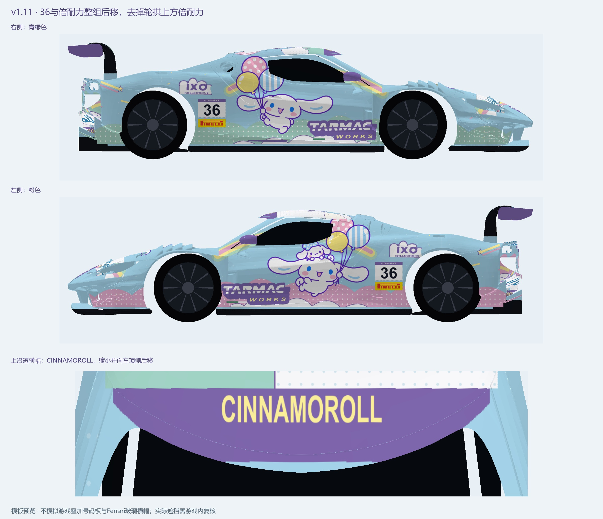

# acc_skin_296gt3_cinnamoroll

《神力科莎：竞速》（Assetto Corsa Competizione，ACC）Ferrari 296 GT3 (2023) 玉桂狗涂装。

**当前版本：v1.12 · Cloud Parade 36 · 36号**

## 下载

- [ACC安装包](packages/v1.12/Ferrari_296_GT3_Cinnamoroll_CloudParade36_v1_12.zip)
- [编辑源文件包](packages/v1.12/Ferrari_296_GT3_CloudParade36_v1_12_编辑源文件.zip)：4096×4096、10层PSD、PNG、SVG及素材。
- [GitHub发行与版本下载](https://github.com/charwxxxmy/acc_skin_296gt3_cinnamoroll/releases)
- [安装方法](docs/安装说明.md) · [更新记录](CHANGELOG.md) · [本版说明](docs/本版更新.md) · [文件校验值](SHA256SUMS.txt)

## 本版变化

- 参考Hello Kitty同车型文件，在前保险杠左右灯下各增加一枚倍耐力；保留参考文件的296 UV位置和方向。
- 删除车尾和后机盖上与尾翼重复的Cinnamoroll长艺术字，没有添加替换文字。
- 尾翼艺术字、车尾角色、云团及车队网址保留。
- 沿用v1.11的侧面36＋倍耐力组合及CINNAMOROLL短横幅。
- 新增独立前脸标志层，源文件为10层PSD。
- 包和游戏显示名更新为v1.12；安装目录沿用v111，直接覆盖游戏内v1.11。

预览为车辆模板曲面渲染。侧面白底FANATEC号码板由游戏叠加；车身上沿短横幅与玻璃上的Ferrari横幅分属不同区域。

前脸位置参考本地Hello Kitty同车型文件；原始压缩包与R8素材保留在本地。角色、商标及第三方图形的权利归各自权利人所有。
