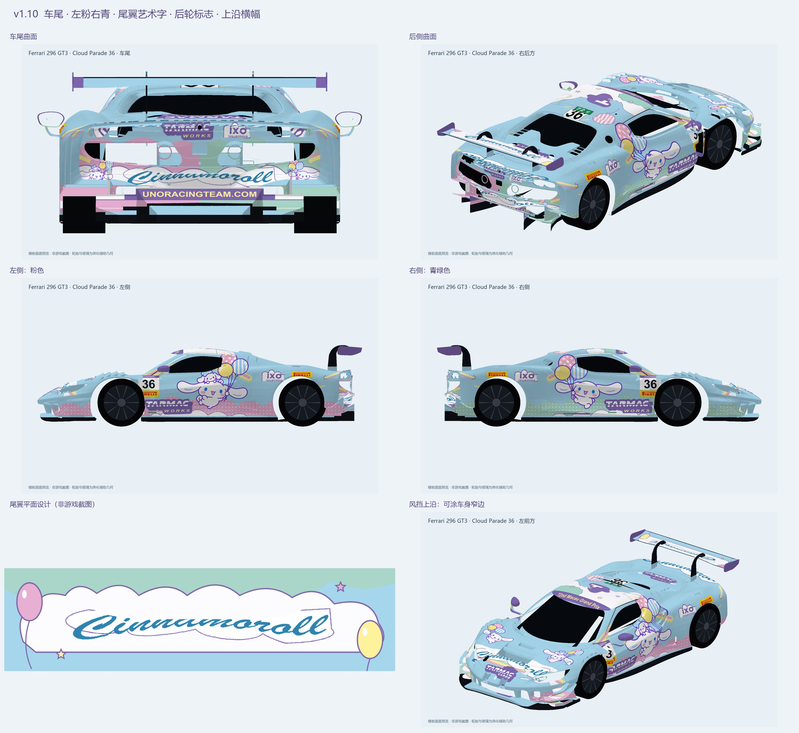
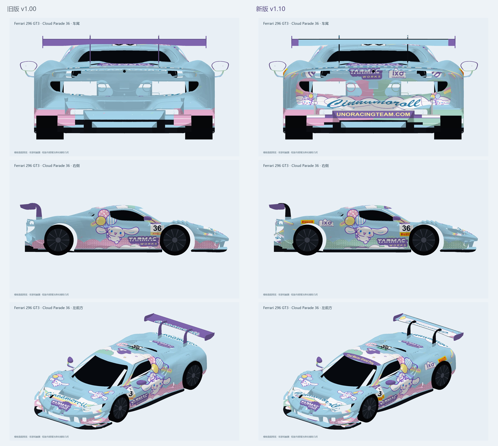

# acc_skin_charwxxxmy

《神力科莎：竞速》（Assetto Corsa Competizione，ACC）自定义车辆涂装。

当前版本：**Ferrari 296 GT3 (2023) · 玉桂狗 Cloud Parade 36 v1.10**，车号36。

## 下载

- [ACC安装包](packages/v1.10/Ferrari_296_GT3_Cinnamoroll_CloudParade36_v1_10.zip)：包含正确的 `Customs/Cars` 与 `Customs/Liveries` 目录，约2.8 MB。
- [编辑源文件包](packages/v1.10/Ferrari_296_GT3_CloudParade36_v1_10_编辑源文件.zip)：含4096×4096、9层PSD、PNG、SVG和素材，约41.3 MB。
- [安装说明](docs/安装说明_v1.10.txt) · [完整交付说明](docs/交付说明_v1.10.md) · [验证报告](docs/验证报告_v1.10.json) · [文件校验值](SHA256SUMS.txt)

打开文件后点击 GitHub 的下载按钮；安装包需先解压，再将 `Customs` 合并到系统“文档”中的 `Assetto Corsa Competizione` 文件夹。不要放进Steam游戏安装目录。

## 版本内容

恢复左粉右青的波点云团；车尾加入角色、彩虹、艺术字及车队网址；尾翼改为浅蓝白云并复用R8原作Cinnamoroll艺术字；后轮上方补充IXO、倍耐力和流星。倍耐力使用官方图形。

紫色横幅位于挡风玻璃上沿可涂装的车身窄边，玻璃本身仍采用ACC内置选项。

## 验证状态与素材出处

文件、压缩包完整性、贴图与PSD一致性和模型曲面预览检查通过，**尚未在ACC游戏内验证**。预览为模板渲染，轮胎和玻璃使用简化辅助几何。

本作以R8玉桂狗涂装为参考重新适配296 GT3，角色沿用本项目v1.00的图像生成补全素材。艺术字、Tarmac Works及IXO从本地R8可编辑图层只读提取；Pirelli图形来自[官方新闻站点](https://press.pirelli.com/)。更多出处见[交付说明](docs/交付说明_v1.10.md)。角色、商标与第三方素材的权利归各自权利人所有，本仓库没有为它们另行授予开源许可。

本仓库仅保存本次296 v1.10交付；原始涂装包、R8成果和工作环境保留在本地。
